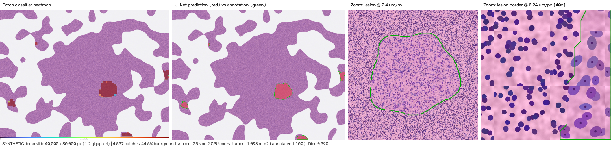
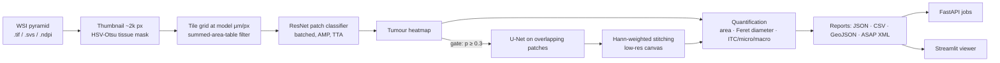

# PathoVision AI

**Whole-slide image analysis for breast-cancer metastasis detection in H&E lymph-node sections.**

Gigapixel slides (~100,000 × 200,000 px, ~60 GB as raw RGB) are processed patch by patch from the image pyramid. The pipeline detects tissue, classifies patches with a CNN, segments tumour with a U-Net, blends overlapping predictions into one probability map, and measures every lesion (area, largest diameter, clinical size category). Results are served through a FastAPI job service and an interactive Streamlit viewer, and exported as GeoJSON for QuPath.

> Research prototype for learning and portfolio purposes. Not a medical device; not for diagnostic use.


*Pipeline output on a **synthetic** slide from `scripts/demo_synthetic.py` (shows the mechanics: heatmap, segmentation vs. annotation, multi-resolution zoom). Replace with CAMELYON16 screenshots after training on real data.*

---

## Results

> **Fill this table from your own run** of `notebooks/train_on_colab.ipynb` (or the Kaggle version) (numbers are written to `runs/*/metrics.json` and `outputs/holdout/*/report.json`). Do not copy numbers from papers.

| Task | Data | Model | Metric | Value |
|---|---|---|---|---|
| Patch classification | PCam test (32,768 patches) | ResNet-18, 8× TTA | ROC-AUC / F1 | _ / _ |
| Tumour segmentation | CAMELYON16 held-out slides | ResNet34-U-Net | Dice / IoU | _ / _ |
| Slide throughput | CAMELYON16 slide, T4 GPU | full pipeline | patches/s, s/slide | _ / _ |
| Memory | same | full pipeline | peak RAM / GPU (MB) | _ / _ |

---

## Pipeline



| Stage | What it does | Where |
|---|---|---|
| Reading | Resolution-aware reads (`read_at_mpp`) from the best pyramid level; never loads the full slide | `pathovision/wsi/reader.py` |
| Tissue detection | HSV saturation + Otsu, morphology, hole filling; skips 70-90% of a slide | `pathovision/wsi/tissue.py` |
| Tiling | Grid in level-0 coords, O(1) tissue fraction per tile via integral image | `pathovision/wsi/tiler.py` |
| Annotations | CAMELYON ASAP XML incl. exclusion polygons → masks; predictions → GeoJSON/XML | `pathovision/wsi/annotations.py` |
| Stain handling | Macenko normalisation, HED stain jitter | `pathovision/preprocessing/stain.py` |
| Models | ResNet/EfficientNet/DenseNet classifier; U-Net and ResNet-encoder U-Net | `pathovision/models/` |
| Training | AMP, one-cycle LR, early stopping on val AUC/Dice, threshold chosen on val, TTA | `pathovision/training/` |
| Inference | Batched DataLoader inference, gated segmentation, overlap blending | `pathovision/inference/` |
| Quantification | Lesion area, max Feret diameter (convex hull), size category, tumour burden | `pathovision/inference/quantify.py` |
| Serving | Async FastAPI jobs; Streamlit viewer with lesion zoom and patch inspector | `pathovision/api/`, `app/` |

### Engineering notes

- **Physical resolution, not pyramid level.** Each checkpoint stores the `mpp` and `patch_size` it was trained at; inference reads patches at exactly that resolution, whatever the scanner.
- **Memory is independent of slide size.** Patches stream through a DataLoader; probability maps live on a canvas at 1/32 resolution (~156 MB for a 100k × 200k slide instead of ~80 GB at level 0).
- **No seams.** Segmentation patches overlap 25% and are blended with a Hann window; tile edges are rounded from level-0 coordinates so adjacent tiles never leave 1-px gaps (unit-tested).
- **Cascade.** The cheap classifier runs on all tissue; the U-Net only runs where the classifier is suspicious.
- **No leakage.** Train/val/test splits are by slide (`scripts/extract_patches.py`).

---

## Quick start

```bash
git clone https://github.com/nirdoshk0228/pathovision-ai.git && cd pathovision-ai
pip install -r requirements.txt
pytest -q                              # unit + end-to-end tests (CPU, ~1 min)
```

### 1. CPU demo, no downloads (~10-15 min)

Generates synthetic pyramidal slides with tumour annotations, trains small models from scratch, and analyses a held-out **1.2-gigapixel** slide:

```bash
python scripts/demo_synthetic.py       # --quick for a ~5 min version
streamlit run app/streamlit_app.py
```

The synthetic data only proves the pipeline works end to end. Real results come from step 2.

### 2. Train on real data (free GPU: Colab or Kaggle)

Upload `notebooks/train_on_colab.ipynb` to Google Colab (Runtime → T4 GPU → Run all; results are saved to Google Drive), or open `notebooks/train_on_kaggle.ipynb` on Kaggle (GPU + Internet on). Either notebook:

1. downloads **PatchCamelyon** (327k patches, Zenodo) and trains the ResNet-18 classifier;
2. downloads a few **CAMELYON16** slides with annotations from the AWS Open Data bucket (`s3://camelyon-dataset`, no account needed);
3. extracts slide-split patches and trains the ResNet34-U-Net;
4. runs whole-slide inference and evaluation on held-out slides, and benchmarks throughput.

Or run the same steps locally:

```bash
bash scripts/download_data.sh pcam
python -m pathovision.training.train_classifier --data-dir data/pcam --arch resnet18 --epochs 6 --out-dir runs/cls

N_TUMOR=6 N_NORMAL=2 bash scripts/download_data.sh camelyon
python scripts/extract_patches.py --slides "data/camelyon16/images/*.tif" --xml-dir data/camelyon16/annotations \
    --out data/patches --val-slides tumor_005 --test-slides tumor_006 --no-cls
python -m pathovision.training.train_segmentation --data-dir data/patches/seg --arch resnet34_unet --epochs 20 --out-dir runs/seg
```

### 3. Analyse a slide

```bash
python -m pathovision.inference.slide_inference --slide data/slides/tumor_001.tif \
    --cls-ckpt models/classifier.pt --seg-ckpt models/segmenter.pt \
    --gt-xml data/slides/tumor_001.xml --out outputs/tumor_001 --tta 8
```

Writes `report.json`, `lesions.csv`, `tiles.csv`, `heatmap_overlay.png`, `prediction_overlay.png`, `tumor_mask.png`, `prob_map.npy`, `predictions.geojson` (QuPath) and `predictions.xml` (ASAP).

### 4. API

```bash
PV_CLS_CKPT=models/classifier.pt PV_SEG_CKPT=models/segmenter.pt PV_SLIDE_DIR=data/slides \
    uvicorn pathovision.api.main:app --port 8000
curl -F slide_name=tumor_001.tif -F tta=1 localhost:8000/analyze      # -> {"job_id": "..."}
curl localhost:8000/jobs/<job_id>                                      # status, progress, summary
curl -O localhost:8000/jobs/<job_id>/files/predictions.geojson
```

Swagger docs at `http://localhost:8000/docs`.

### 5. Benchmark

```bash
python scripts/benchmark.py --slide data/slides/tumor_001.tif --cls-ckpt models/classifier.pt \
    --batch-sizes 64 256 512 --workers 0 2 4
```

---

## Repository layout

```
pathovision/
  wsi/            reader (pyramid, mpp), tissue mask, tiler (integral image), annotations (ASAP/GeoJSON)
  preprocessing/  Macenko stain normalisation, HED jitter
  data/           PCam / Kaggle-HCD / segmentation / WSI-tile datasets, D4 + stain augmentation
  models/         patch classifier, U-Net, ResNet-U-Net
  training/       train_classifier, train_segmentation, losses (BCE+Dice, focal), engine (TTA)
  evaluation/     classification and segmentation metrics
  inference/      slide_inference (pipeline + CLI), stitching, quantification, visualisation
  api/            FastAPI service
  utils/          checkpoints with preprocessing metadata, timers, synthetic slide generator
app/              Streamlit dashboard
scripts/          download_data.sh, extract_patches, demo_synthetic, evaluate_slides, benchmark
notebooks/        train_on_colab.ipynb, train_on_kaggle.ipynb
tests/            unit tests + end-to-end test on a synthetic pyramidal slide
docs/             INTERVIEW_PREP.md, RESUME.md
```

---

## Roadmap

- Attention-based multiple-instance learning (ABMIL / CLAM) for slide labels without pixel annotations
- FROC lesion-level evaluation (CAMELYON16 protocol)
- Pathology foundation-model features (UNI / CONCH) as the patch encoder
- ONNX / TensorRT export and INT8 quantisation
- Blur and artefact detection; multi-centre validation on CAMELYON17

## Data and references

- **PatchCamelyon**: Veeling et al., *Rotation Equivariant CNNs for Digital Pathology*, MICCAI 2018. [github.com/basveeling/pcam](https://github.com/basveeling/pcam) (CC0)
- **CAMELYON16/17**: Litjens et al., *1399 H&E-stained sentinel lymph node sections of breast cancer patients: the CAMELYON dataset*, GigaScience 2018. [registry.opendata.aws/camelyon](https://registry.opendata.aws/camelyon/) (CC0)
- Ronneberger et al., *U-Net*, MICCAI 2015 · He et al., *ResNet*, CVPR 2016
- Macenko et al., *A method for normalizing histology slides for quantitative analysis*, ISBI 2009
- Tellez et al., *Quantifying the effects of data augmentation and stain color normalization in CNNs for computational pathology*, MedIA 2019
- Lu et al., *Data-efficient and weakly supervised computational pathology on whole-slide images (CLAM)*, Nature BME 2021

## License

MIT
